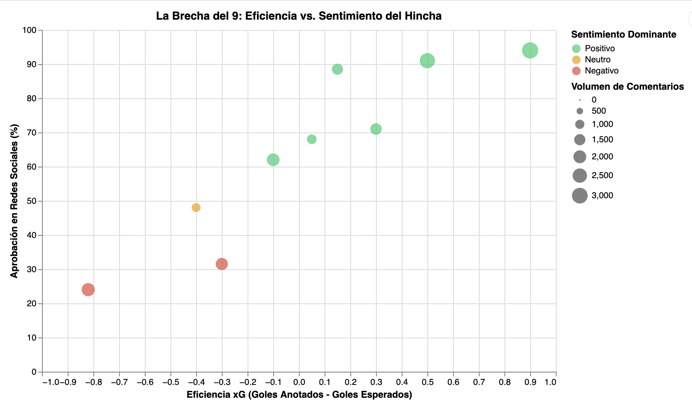

# La dictadura del xG: Cuando el gol no basta para calmar a las redes

**Por:** Adalú Salas  
**Fecha:** 15 de octubre de 2026  

---

En el fútbol contemporáneo, la figura del delantero centro ("9") vive atrapada en una doble contabilidad. Por un lado, la frialdad de los modelos analíticos basados en *Expected Goals* ($xG$) juzga la probabilidad matemática de que un disparo se convierta en gol según la posición, el ángulo y la presión defensiva. Por el otro, el tribunal instintivo e inmediato de las redes sociales sentencia la reputación del jugador en cuestión de segundos tras el pitazo final.

El análisis gráfico de 18 actuaciones representativas de los principales atacantes del *Big Six* de la Premier League revela una grieta profunda entre el análisis técnico y el veredicto emocional del hincha en plataformas como X e Instagram.

### Los intocables y la tiranía de la expectativa

Erling Haaland y Viktor Gyökeres representan el ideal del atacante inmune a la volatilidad digital. En partidos donde Haaland supera su expectativa de gol —registrando eficiencias de $xG$ de $+0.15$ y $+0.90$—, el porcentaje de aprobación popular alcanza máximos del $88.5\%$ y $94.0\%$, impulsado por volúmenes masivos de conversación que superan los 3.000 comentarios por fecha. La masa digital premia la contundencia absoluta: cuando la pelota entra, el margen de duda se extingue.

Sin embargo, el fenómeno más revelador ocurre en la periferia de esa efectividad perfecta. Jugadores como Nicolas Jackson (Chelsea) o Rasmus Højlund (Manchester United) encarnan "La Brecha". En la jornada del 22 de agosto, Jackson registró un $xG$ de $0.82$, lo que significa que el modelo estadístico predecía que un delantero promedio debería haber marcado casi un gol con las oportunidades generadas. Su casillero de goles reales finalizó en cero. El veredicto digital fue devastador: apenas un $24.0\%$ de aprobación y una marea de más de 2.100 comentarios con sentimiento predominantemente negativo.

### El "efecto gol" como amortiguador digital

La evidencia recopilada demuestra que la percepción en redes sociales padece de una miopía severa respecto a la generación de juego. Mientras que la analítica de datos valora el desmarque y la capacidad de situarse en posiciones de alto $xG$ como un indicador de rendimiento a largo plazo, la hinchada opera bajo una lógica binaria: gol o condena.

Un caso ilustrativo es el de Darwin Núñez en Liverpool. A pesar de registrar una eficiencia de $xG$ levemente negativa ($-0.10$), el simple hecho de mandar el balón a la red elevó su índice de aprobación al $62.0\%$. El gol actúa como un amortiguador mediático que invisibiliza las fallas de definición previas, protegiendo al delantero del linchamiento digital.

En conclusión, la visualización expone cómo las redes sociales no miden la calidad técnica integral del futbolista, sino el nivel de frustración o euforia inmediata del aficionado. En una Premier League donde los millones en fichajes amplifican las expectativas, la distancia entre el rendimiento numérico real y la percepción pública sigue siendo la brecha más difícil de acortar para un delantero centro.
